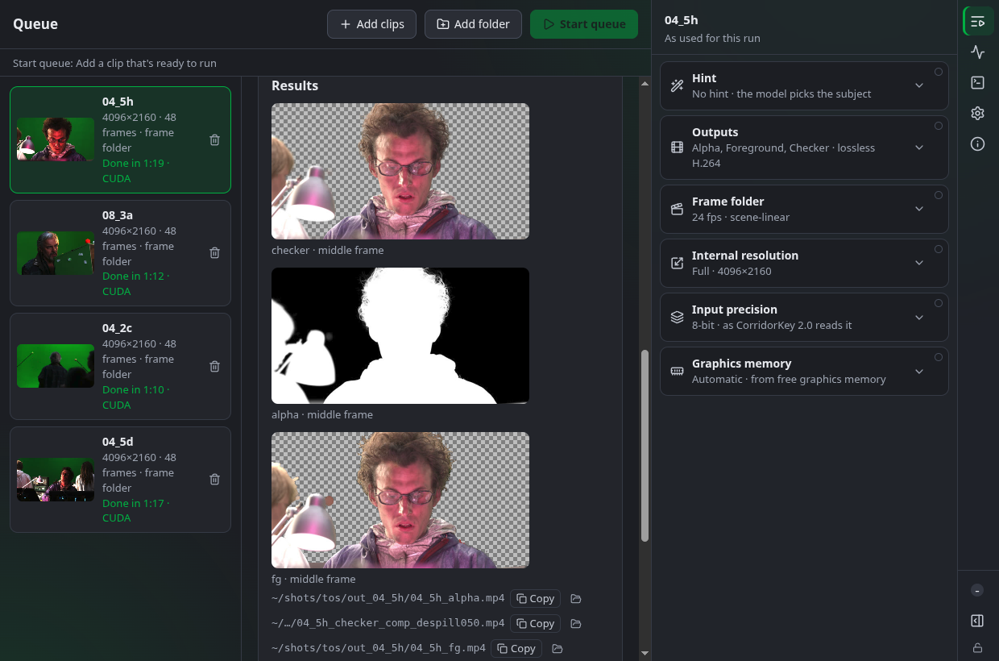
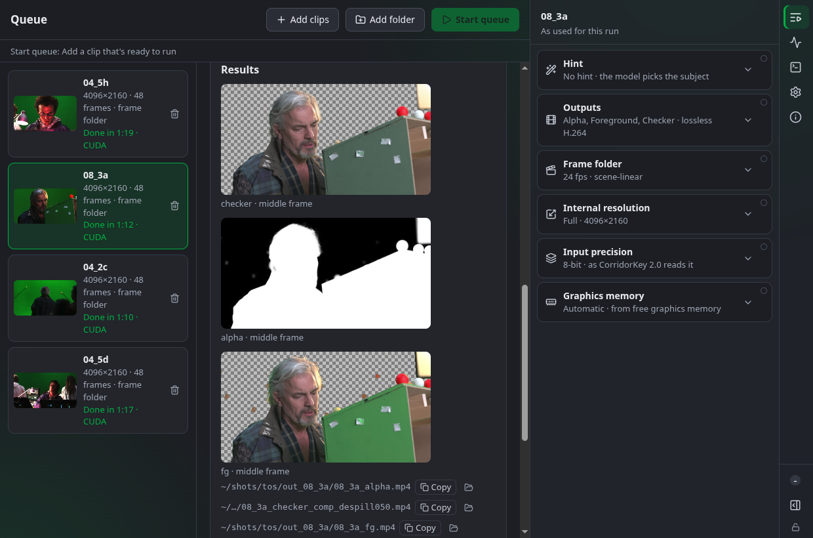
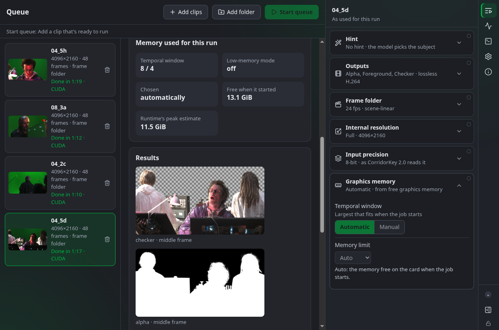
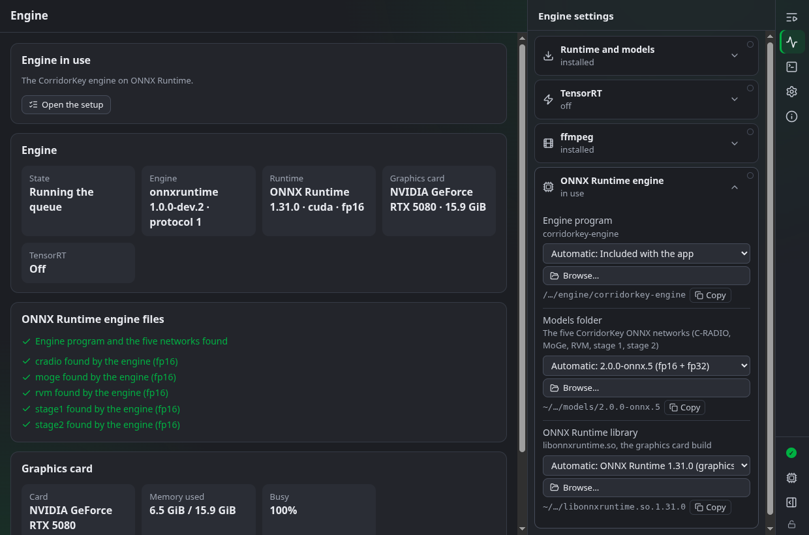
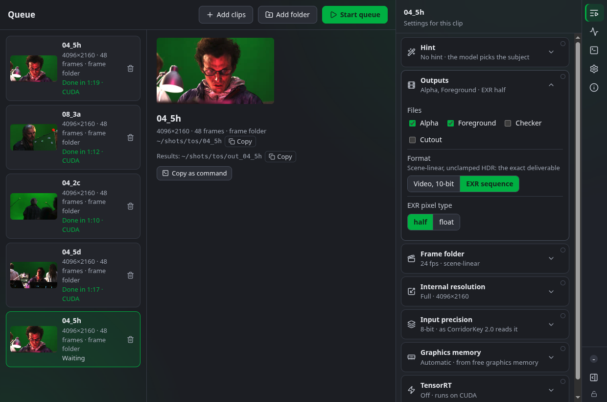
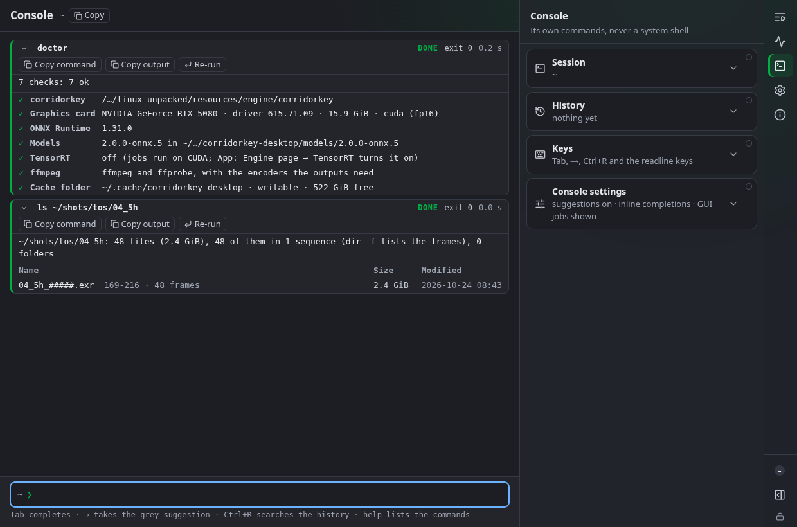
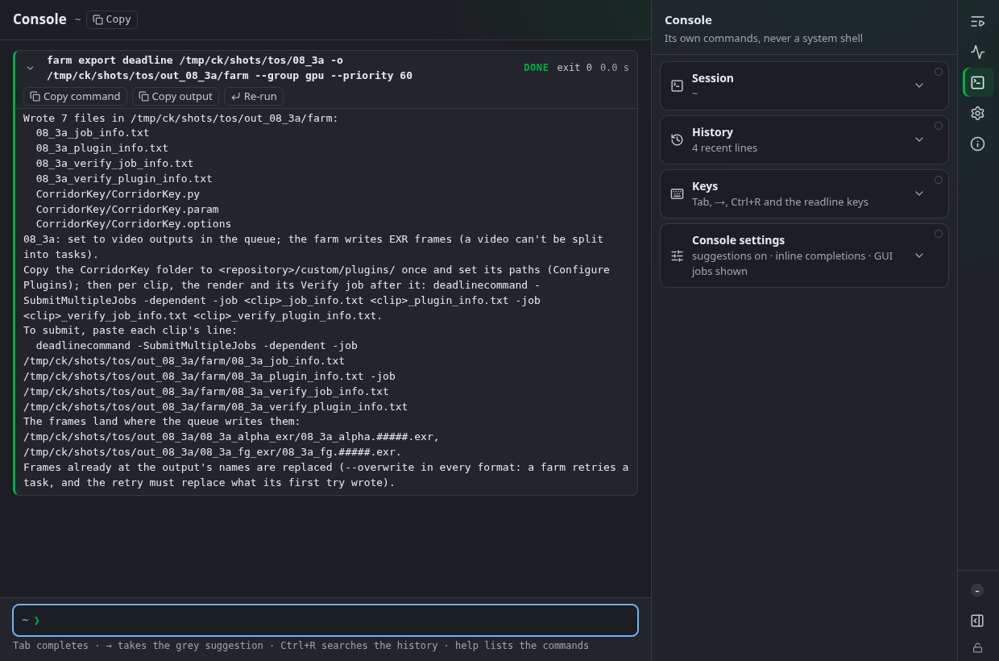
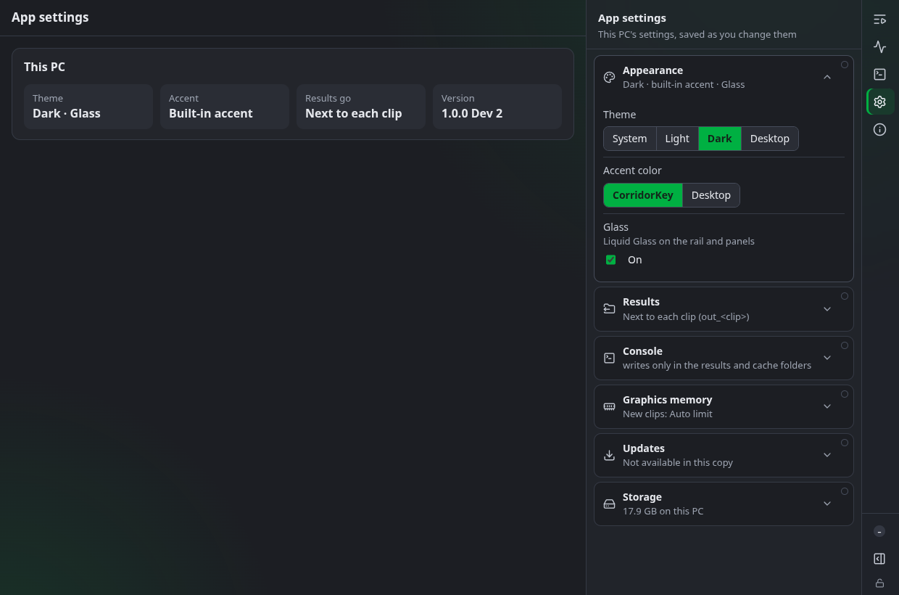

# CorridorKey Desktop

  

Download 1.0.0-dev.9 for Linux, Windows or Apple Silicon Macs from the
[releases page](https://github.com/MarcelineVPQ/corridorkey-desktop/releases/tag/v1.0.0-dev.9).

**The numbers and how we measured them:** [Engineering notes](ENGINEERING.md), covering speed, quality, test machines
and what we got wrong.

> **A community project, not made or endorsed by Corridor Digital.** The CorridorKey model is theirs; their official
> app and plugins are at [corridorkey.com](https://corridorkey.com).

## What it is

A free desktop app for [CorridorKey 2.0](https://github.com/nikopueringer/CorridorKey2.0),
Corridor Digital's AI green-screen keyer (model by Zachary Harris). Drop clips in, pick a hint
mode and outputs, and watch real progress: frames written, the temporal window the runtime
chose from your free graphics memory, and stills of the results.

The model is Corridor's. What's new is the engine around it: no Python, nothing to set up, and it keys on
your own graphics card. Huge thanks to Niko, Zachary Harris and the Corridor crew.

Status: 1.0 is almost ready. The development builds (1.0.0-dev.N) key on Linux with an NVIDIA graphics card and on
Apple Silicon Macs, at HD and 4K. On Windows they install and run, but keying on a real Windows PC with an NVIDIA card
hasn't been tested yet (Requirements).

## Get started

1. Download the file for your system from the
   [releases page](https://github.com/MarcelineVPQ/corridorkey-desktop/releases/tag/v1.0.0-dev.9): the AppImage
   (Linux), the installer (Windows) or the disk image (Apple Silicon Mac).
2. Open it. On first start the setup downloads the GPU runtime and the CorridorKey models once (4.03 GB on Linux,
   3.81 GB on Windows, 5.74 GB on macOS) and offers to install ffmpeg if it's missing.
3. Drop a clip on the window and start the queue.

The wiki walks through it: [Your first key](https://github.com/MarcelineVPQ/corridorkey-desktop/wiki/Your-First-Key).

## Requirements

- **Linux or Windows 10/11 (x64) with an NVIDIA graphics card**, RTX 20-series or newer with 8 GB or more. It runs
  down to an 8 GB RTX 2070 SUPER; the more memory, the larger the temporal window it picks.
- **AMD cards on Linux** from 1.0.0-dev.4. **AMD support is new and not yet tested on a real AMD card: we're testing it
  ourselves next. If it doesn't work on your card, please tell us on
  [GitHub issues](https://github.com/MarcelineVPQ/corridorkey-desktop/issues).**
- **A Mac with Apple Silicon** (M1 or newer, macOS 14 or newer): 1280×1080, 1920×1080 and 4K clips. 16 GB keys 4K,
  tight. Intel Macs aren't supported.
- Intel graphics cards aren't supported, and nothing falls back to the processor.
- Nothing else to install by hand: the setup fetches what it needs, and offers ffmpeg if it's missing.

**Windows:** the installer isn't code-signed yet. Edge says the installer "isn't commonly downloaded"; to keep it:
**…** (the menu) → **Keep** → **Show more** → **Keep anyway**. Then, the first time, SmartScreen shows "Windows
protected your PC": click **More info**, then **Run anyway**. The Windows build is tested in a virtual machine without an NVIDIA card, so
keying on a real Windows PC with one hasn't been tested yet. If you try it, please tell us how it goes.

Step by step: [Installing on Linux](https://github.com/MarcelineVPQ/corridorkey-desktop/wiki/Installing-on-Linux),
[Installing on Windows](https://github.com/MarcelineVPQ/corridorkey-desktop/wiki/Installing-on-Windows). The full
details (TensorRT, on Linux today, Windows coming; download sizes; the Mac's Core ML engine): [Requirements](ENGINEERING.md#requirements).

## Highlights

- **Faster on the card you have.** On an RTX 5080 writing float EXR, the studio deliverable (2026-10-29, one run per
  clip, the automatic window): 4K about 3.2-3.5× the original's speed, HD and smaller clips 2.6-4.5×; the optional
  TensorRT mode (on Linux today, Windows coming) about 4.4-4.8× at 4K and 4.6-5.7× at HD. Writing video, the gap is
  smaller ([Speed](ENGINEERING.md#speed)).
- **The same mattes.** Measured against the original, frame by frame, on every test clip, hair included
  ([Quality](ENGINEERING.md#quality-the-mattes-against-the-original-and-the-truth)). The optional TensorRT mode differs
  slightly from CUDA: up to about 9.5/255 on 0.2 % of a clip's pixels (measured 2026-10-29).
- **Studio outputs.** EXR named the studio way with the matte in alpha, lossless 10-bit H.264 or DNxHR 444, and 10-
  and 12-bit plates read in full ([Outputs](https://github.com/MarcelineVPQ/corridorkey-desktop/wiki/Outputs)).
- **Colour management.** OpenColorIO 2.5 built in: ACES, the camera log spaces, or your studio's own config.
- **Installs itself, no Python.** One file to download; the app fetches the rest, every file checked.
- **Farm-ready.** The `corridorkey` command line, job export for Deadline, OpenCue, Flamenco and OpenJD, and Console
   scripts from cron ([wiki: Render farm](https://github.com/MarcelineVPQ/corridorkey-desktop/wiki/Render-Farm)).
- **Free.** It stays free, and every speed and quality claim comes with how it was measured.

## Screenshots

<table>
  <tr>
    <td width="50%" valign="top"> Grey hair against a busy set, keyed at 4K.</td>
    <td width="50%" valign="top"> A finished job: the memory it used and the settings it ran with.</td>
  </tr>
  <tr>
    <td width="50%" valign="top"> The Engine page during a job: CUDA, onnx.5, the card busy.</td>
    <td width="50%" valign="top"> Outputs: an EXR sequence in half float, the studio deliverable.</td>
  </tr>
  <tr>
    <td width="50%" valign="top"> The Console: doctor checks the setup, ls reads an EXR sequence.</td>
    <td width="50%" valign="top"> The Console exporting a clip as a Deadline farm job.</td>
  </tr>
  <tr>
    <td width="50%" valign="top"> App settings: Dark, the CorridorKey accent, Glass.</td>
    <td width="50%"></td>
  </tr>
</table>

## Why this exists

On 21 October 2026 Corridor Crew released [CorridorKey 2.0](https://github.com/nikopueringer/CorridorKey2.0). I
purchased CK2.0 straight away, and only after paying did I see that Linux isn't supported yet. I'm an audio/video
engineer, and I've moved PyTorch projects to Rust and ONNX Runtime before, so I took Corridor's model, gave it a new
engine (Rust on ONNX Runtime, no Python), and wrapped it in a desktop app that installs itself.

Marcy ([MarcelineVPQ](https://github.com/MarcelineVPQ))

## What's coming

Next: keying tested on a real Windows PC with an NVIDIA card, 4K at 1 fps on a 16 GB Mac, a fully offline install for
air-gapped studios, and the documented DaVinci Resolve round trip. After 1.0: Nuke reading our outputs as they are, and
more for studio pipelines. The full list: [What's coming](ENGINEERING.md#whats-coming) and
[docs/BACKLOG.md](docs/BACKLOG.md).

## Learn more

- The wiki: [Home](https://github.com/MarcelineVPQ/corridorkey-desktop/wiki),
  [Installing on Linux](https://github.com/MarcelineVPQ/corridorkey-desktop/wiki/Installing-on-Linux),
  [Installing on Windows](https://github.com/MarcelineVPQ/corridorkey-desktop/wiki/Installing-on-Windows),
  [Your first key](https://github.com/MarcelineVPQ/corridorkey-desktop/wiki/Your-First-Key),
  [Outputs](https://github.com/MarcelineVPQ/corridorkey-desktop/wiki/Outputs),
  [Troubleshooting](https://github.com/MarcelineVPQ/corridorkey-desktop/wiki/Troubleshooting),
  [Uninstall](https://github.com/MarcelineVPQ/corridorkey-desktop/wiki/Uninstall).
- [Engineering notes](ENGINEERING.md): the numbers and how we measured them, the test machines, and what we got wrong.

## Licence and credits

CorridorKey is © Corridor Digital, under the CorridorKey licence (see LICENSE). This app is
free and stays free. Organisations with more than US $20M annual revenue need CorridorKey
plugin seats ([corridorkey.com](https://corridorkey.com)). Foundation models: C-RADIO (NVIDIA),
MoGe (Microsoft), RVM (Google DeepMind); see the CorridorKey repository's notices.

Built by Marcy ([MarcelineVPQ](https://github.com/MarcelineVPQ)) at 42 Pixel Studios.
